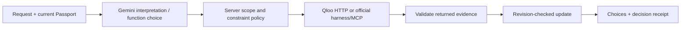

# TastePassport AI

**Move anywhere. Keep your vibe.**

TastePassport is a cultural discovery agent for people settling into a new city. It starts with the music, films, food, and other culture someone already loves, then uses Qloo to find real places and cultural discoveries, Gemini to understand requests, and server-side policy to preserve preferences as the user explores.

[Try the public app](https://tastepassport-ai-production.up.railway.app/) · [Project guide and demo](docs/PROJECT_GUIDE.md) · [MIT license](LICENSE)

## Why it exists

A new address does not create a sense of belonging. Popular city lists show what everyone visits; they rarely connect a newcomer’s existing tastes to a useful next step. Asking a language model for “Indian restaurants in London” can produce plausible prose, but it does not give this app’s confirmed Qloo entities, returned cultural associations, shared-profile evidence, or a Passport that remembers what the person accepted and rejected.

TastePassport turns those signals into a decision: **a few grounded choices, a conversation that respects constraints, and an outing the user can shape**. It works as a guest; an account is optional.

## A judge’s first journey

1. Choose a destination and one to five interests, such as **A.R. Rahman**, **Interstellar**, and **Indian cuisine**. Confirm ambiguous names instead of silently accepting the wrong entity.
2. Explore selected categories. Qloo supplies the actual entities; the app checks type, locality, exclusions, and available price/rating evidence. Place cards and cultural content are clearly distinguished.
3. Ask TastePassport: **“Find cheaper vegetarian Indian food. Keep my music and movies unchanged.”** Then follow with **“Make those cheaper.”** The agent applies supported constraints to Food, retains untouched sections, and reports what actually changed.
4. Save choices to **My Vibe**, compare confirmed profiles with **Together**, and assemble a dated outing with real place stops. Reordering preserves the selected venues; replacing one is deliberate.
5. Optionally save a Passport, a dated plan, or a named taste profile to reuse in another city. An already-saved Passport keeps later My Vibe and preference changes; a fresh Passport does not silently overwrite it.

## The Qloo advantage

The product depends on Qloo for identity confirmation, cross-domain discovery, real entity metadata, cultural associations, and shared tastes. Gemini interprets the request and can select supported Qloo tools through native function calling; it does **not** invent the recommendation catalogue.

| Customer action | Qloo-backed operation |
|---|---|
| Confirm a taste or concept | Entity search/details and returned taxonomy tags |
| Find choices in a new city | Insights with confirmed taste signals, output type, geography, and supported filters |
| Explain a result honestly | Returned metadata, query provenance, and available positive contribution evidence |
| Find common ground | Analysis Compare, followed by grounded joint discovery |
| Refine dynamically | Validated direct Qloo calls and supported official harness/MCP tools |

In Insights, `filter.type` specifies the **output** type; an artist or movie can be an input taste while `urn:entity:place` is the requested output for dining. Dining, cafés, and cinemas are place activities, not invented Qloo entity types. Music discovery means artists, not a promise of local concerts. Qloo-returned affinity is not advertised as a probability that a particular person will like a result.

## What makes it agentic

Ask TastePassport maintains a revision-checked Passport across turns. Native Gemini (`@google/genai`, Vertex AI Express Mode) interprets language and selects allowed functions where useful. The server validates intent and tool arguments, retrieves Qloo evidence, checks requirements, commits only permitted sections, and composes a grounded reply. Known read-only questions and guided controls can act without an unnecessary model call. A bounded function-call loop, cancellation, fallback, and metadata-only logs make the execution observable without exposing prompts or secrets.



Recommendations use confirmed inputs and output-specific retrieval first, then explicit-filter validation, rank fusion for Balanced discovery, deduplication, and bounded first-three diversity. Familiar content prioritizes same-domain seeds while adjacent discovery can add culturally interesting options. These are product ranking rules, not a certified relevance score. Explanations distinguish a returned audience association from a proven causal reason.

## Build and run

Requires Node.js 24+ and npm. Copy `.env.example` to ignored `.env.local`, then set server-only provider credentials securely:

```sh
npm ci
cp .env.example .env.local
npm run dev -- --port 3000
```

Required for live discovery: `QLOO_API_KEY` and `QLOO_API_BASE_URL=https://hackathon.api.qloo.com`. Native Gemini uses `GEMINI_API_KEY` (or `GOOGLE_API_KEY`) and configurable `GEMINI_MODEL`; the default is `gemini-3.1-flash-lite`. Vertex AI Express Mode needs no Gemini base URL, project, or location. Optional account persistence uses `SUPABASE_URL`, `SUPABASE_PUBLISHABLE_KEY`, `SUPABASE_SERVICE_ROLE_KEY`, and `APP_ORIGIN`. Never commit credentials or put server keys in `NEXT_PUBLIC_` variables.

For a fresh/reset Supabase database, run the single [db-scripts/setup.sql](db-scripts/setup.sql) **manually** in the SQL Editor. It deletes app-owned saved data and active sessions while preserving Auth users and existing destination rows. Do not run it as part of deployment.

```sh
npm run check:docs
npm test
npm run typecheck
npm run build
npm run smoke:production
```

Local automated tests and the mocked browser contract verify implementation behavior; they do not prove that external providers or hosted accounts are currently healthy. Before submission, rehearse the full guest and agent journey on the actual public deployment. [The project guide](docs/PROJECT_GUIDE.md) covers endpoint mapping, architecture, ranking, operations, demo script, submission copy, verification commands, and limits.

## Hackathon fit and honest boundaries

The [Qloo Agentic Hackathon](https://qloo.devpost.com/) asks for an agent-powered use case whose value depends on cultural intelligence rather than generic LLM output. TastePassport’s distinguishing outcome is **cultural continuity through a move**: confirmed tastes become Qloo-grounded discoveries, conversationally adaptable choices, common ground with another person, and a practical outing. The code is public under [MIT](LICENSE).

The app does not book venues, verify opening hours, provide live showtimes, guarantee travel timing, or certify ingredients or allergens. Qloo coverage and image availability vary by destination. The model-only comparison is illustrative, not a controlled proof of superiority. The public demo, public repository/branch, license, description, and current Devpost rules must be checked together before final submission.
