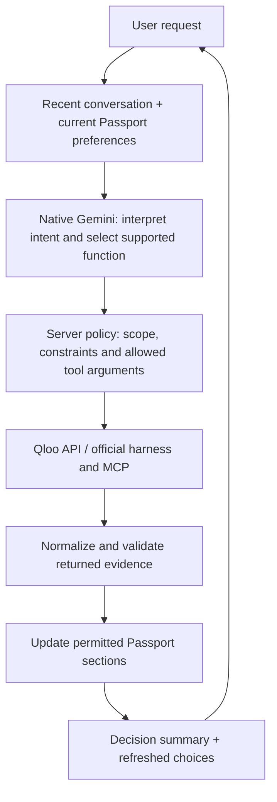

# TastePassport AI

### Move anywhere. Keep your vibe.

**A cultural belonging agent that helps newcomers turn familiar tastes into a life in a new city.**

Start with one artist, film, cuisine or other cultural interest you love; add up to five for a fuller profile. TastePassport uses Qloo’s cultural intelligence to find real discoveries, Gemini to understand your requests, and a stateful agent to refine your choices without losing the preferences you already gave it. Find your own places, discover common ground with someone else, and turn recommendations into an outing.

**[Open the app](https://tastepassport-ai-production.up.railway.app/)** · [Watch/record the demo](docs/DEMO_SCRIPT.md) · [Submission story](docs/DEVPOST_SUBMISSION.md) · [Technical architecture](docs/AGENT_ARCHITECTURE.md)

## The problem: a new address is not a sense of belonging

Moving cities means rebuilding everyday routines: where to eat, what to do, and how to connect with people. Popularity lists tell you what everyone visits. They rarely start with the music, films and food that make **you** feel at home.

A newcomer also needs help deciding. A long recommendation list becomes useful only when they can say “cheaper,” “vegetarian,” or “keep dinner, but add a cinema”—and have those instructions respected.

TastePassport connects **cultural continuity with practical next steps**. The goal is a few meaningful choices and an adaptable outing, rather than simply more search results.

## The experience

Imagine moving from Bengaluru to Toronto with **A.R. Rahman, Interstellar and Indian cuisine** in your taste profile.

1. **Bring your tastes.** Confirm the matching artist, film and cuisine so similarly named entities do not silently become the wrong signals.
2. **Discover your new city.** Choose the categories you want. Qloo returns real places and cultural entities; available addresses, ratings and images help you assess them.
3. **Refine through conversation.** Ask: “Find cheaper vegetarian Indian food in Toronto. Keep my music and movies unchanged.” The agent resolves the relevant concepts, applies supported constraints and updates the requested section.
4. **Continue without starting over.** Say “Make those cheaper.” The agent uses the conversation and current preferences, preserves unrelated sections, and reports the actual change.
5. **Do something with the result.** Build and reorder an outing, swap one stop, or find a real cinema while keeping dinner. Use Together to discover shared cultural ground with another confirmed taste profile.

**Discovery works without an account and needs only one confirmed taste.** When you choose **New Passport**, you can save your current tastes under a required profile name or continue without saving. Signed-in users find their saved taste profiles on the start screen, select one to fill their interests, and reuse it in another city. Saved Passports and dated plans remain separate.

## Why this needs Qloo

An LLM can describe a city and write an appealing itinerary. TastePassport uses Qloo to ground its choices in **returned cultural entities, cross-domain associations and profile comparisons**. Gemini interprets the request; it does not invent the recommendation catalogue or assign unsupported taste scores.

| Product action | Qloo capability used | What it contributes |
|---|---|---|
| Understand “what I love” | Entity search, tag lookup and entity details | Confirmed identities and concepts instead of guessed names |
| Connect familiar tastes to new discoveries | Insights with confirmed entity/tag signals | Cross-domain recommendations grounded in Qloo’s taste graph |
| Respect the destination and preferences | Supported place, location, price, rating and tag filters | Relevant candidate retrieval followed by application validation |
| Find common ground | Analysis Compare, followed by discovery using the profiles | Returned shared associations for the Together experience |
| Explore cultural context | Tag, geographic-affinity and aggregate-demographic Insights | Additional context where the API returns usable evidence |
| Refine a request dynamically | Official Qloo harness/MCP tag lookup and ranking | Model-selected tools working with real Qloo results |

`filter.type` specifies the **requested output entity type**; input taste signals can come from other domains. Local dining and cinema discovery use places. Artists and movies are cultural discoveries, not claims about local concerts or screenings.

Historical-data views and background history lookups have been removed. Trend-biased discovery remains separate. The project does not claim full support for every Qloo capability. [Exact endpoints, mappings and evidence boundaries →](docs/QLOO_INTELLIGENCE.md)

## How the agent works

**Ask TastePassport is a single stateful, tool-using agent with bounded orchestration.** Native Gemini function calling interprets requests and selects supported tools. Server-side policy controls what can change, validates the results and commits a scoped update.



The important boundary is between **understanding a request** and **authorizing a change**:

- **Conversation context:** up to eight recent cultural messages plus a restricted projection of Passport preferences help resolve follow-ups. Account records and secrets are excluded.
- **Tool execution:** dynamic tag lookup and shortlist ranking can use MCP; established workflows also use validated direct API or harness operations. Every action does not require a new model-selected tool call.
- **State preservation:** explicit cuisine, dietary, budget, rating and category constraints survive supported refinements. Changing discovery style does not erase hard requirements.
- **Result validation:** entity identity, output type, exclusions and applicable numeric requirements are checked before updating the Passport. Missing numeric metadata cannot satisfy a strict numeric requirement.
- **Decision receipts:** responses describe the constraints actually applied and the sections actually changed. Price comparisons use known returned prices; they do not invent savings.
- **Failure recovery:** bounded requests and guided fallback preserve a usable flow. A fallback is not reported as successful native Gemini execution.

Safe backend logs record request/trace identifiers, stages, tool names, status and counts so execution can be followed from **Gemini request → tool selection → Qloo/MCP invocation → result**. They exclude API keys, raw prompts, transcripts and provider payloads.

[State, memory, concurrency, tool boundaries and implementation modules →](docs/AGENT_ARCHITECTURE.md)

The optional home-city field adds the starting point to the Passport cover. It does not fetch origin-city recommendations or infer a cultural profile; confirmed tastes and destination guide discovery.

## Features that turn discovery into a decision

| Feature | What the user gets |
|---|---|
| **Confirmed taste profile** | Resolve ambiguity before it affects recommendations; reuse a named profile in another city |
| **Selected discovery categories** | Explore the domains you want, with place recommendations distinguished from music and film content |
| **Familiar / Balanced / Explore** | Adjust the balance of direct and adjacent discovery while keeping explicit requirements; results can overlap |
| **Conversational refinement** | Express cuisine, budget, atmosphere and rating changes, then continue with contextual follow-ups |
| **My Vibe** | Keep explicit likes and rejection feedback; exclude rejected entities from relevant refreshes |
| **Together** | Compare two confirmed profiles and use returned common ground to discover shared options |
| **Flexible outing planner** | Choose activities and order, swap individual stops and retrieve actual cinema venues |
| **Taste insights** | Find cultural themes for inspiration and areas to explore, with nearby-dining actions; aggregate audience context is optional |
| **Optional accounts** | Save named tastes when starting a New Passport; reuse them from the start screen. Save Passports and dated plans separately; export owned profiles as JSON |

### Matching: relevance before volume

The pipeline resolves real entities, retrieves candidates with the appropriate Qloo output type, applies explicit constraints, then normalizes and diversifies the shortlist. Familiar content prioritizes seeds from its own domain; Balanced uses weighted reciprocal-rank fusion with a limited space for broader discoveries. Automatic cuisine tags do not overwhelm movie or artist signals. Deduplication and chain limits reduce repeated branches. Direct and adjacent discovery pools support different discovery styles.

Name matching helps identify an entity; **it is not a cultural affinity score**. Qloo associations can establish a connection without proving a shared plot, genre or guaranteed enjoyment. When individual evidence is unavailable, explanations acknowledge that the tastes were considered together instead of fabricating a reason.

[Matching policy, algorithm research and controlled live comparisons →](docs/RECOMMENDATION_POLICY.md)

## How the project addresses the judging criteria

| Criterion | What to evaluate in TastePassport |
|---|---|
| **Technological implementation** | Native Gemini function calling, real Qloo retrieval and Compare, MCP tool execution, contextual state, validated updates and regression coverage |
| **Design** | Guest-first onboarding, explicit identity confirmation, a consistent Forest & Butter visual system, responsive cards, a closable assistant and actionable progress/error feedback |
| **Potential impact** | A focused newcomer journey: preserve familiar tastes, narrow choices, find shared interests and assemble an outing in an unfamiliar city |
| **Quality of the idea** | Cultural continuity as the organizing principle: your existing tastes become a portable starting point for discovering a new place and connecting with another person |

The strongest demo is a complete journey: **confirmed tastes → grounded discoveries → a constrained conversational update → a usable outing**. A model-only comparison view is available to inspect the difference in grounding; it is not presented as a measured quality benchmark.

## Engineering and verification

Built with **Next.js, React, TypeScript, Google’s native `@google/genai` SDK, Qloo, MCP and optional Supabase Auth/Postgres**. Styling uses shared theme tokens and a locally hosted Manrope font. Entity photos use returned Qloo image URLs with fallbacks; original decorative artwork is separate from recommendation evidence.

Verification recorded **19 October 2026**:

- **229 tests passed**, covering domain rules, orchestration, provider protocols and UI regressions.
- Strict TypeScript checks, production build and isolated production smoke checks passed.
- Live Gemini acceptance selected `qloo_find_tags`, invoked MCP and received five real matches; the workflow correctly awaited confirmation.
- Live Qloo checks preserved Indian cuisine, vegetarian-option, maximum-price and minimum-rating constraints across all three discovery styles, without changing Music or Movies.
- Contrasting live profiles verified film/artist seed isolation, cuisine-sensitive dining and a completed Together comparison.
- A production-browser conversation check exercised scoped dining refinement, a cheaper follow-up, read-only questions and cinema retrieval while preserving dinner.

These checks establish specific behavior, not a recommendation-quality score. Current Railway deployment, real account/email flows and submission access still require final live acceptance. [Full evidence and release checklist →](docs/RELEASE_CHECKLIST.md)

## Run locally

Requires **Node.js 24+** and npm.

```sh
npm ci
cp .env.example .env.local
```

Enter credentials securely in ignored `.env.local`:

```dotenv
QLOO_API_KEY=<server-only secret>
QLOO_API_BASE_URL=https://hackathon.api.qloo.com
GEMINI_API_KEY=<server-only secret>
GEMINI_MODEL=gemini-3.1-flash-lite
```

The model is configurable. The example names the model exercised in this environment; the SDK’s code fallback is `gemini-2.5-flash`. Provider availability and quotas apply. **Gemini needs no `AGENT_MODEL_BASE_URL`.** The optional compatibility adapter remains available for other provider configurations.

```sh
npm run dev -- --port 3000
```

Open **http://localhost:3000**. Guided discovery is available when Gemini is not configured or is unavailable; Qloo credentials are needed for live discovery.

For accounts, configure `SUPABASE_URL`, `SUPABASE_PUBLISHABLE_KEY`, `SUPABASE_SERVICE_ROLE_KEY` and the schema in [supabase/README.md](supabase/README.md). Set `APP_ORIGIN` to the deployed HTTPS origin. Never put server secrets in public environment variables, browser code or source control.

### Checks and deployment

```sh
npm run check:docs
npm test
npm run typecheck
npm run build
npm run smoke:production
```

Tests use isolated fixtures; opt-in live checks require provider credentials. [Development guide](docs/DEVELOPMENT.md) explains commands and prerequisites. [Railway deployment](docs/RAILWAY_DEPLOYMENT.md) covers the persistent Node runtime, health checks and release steps. Guest sessions currently live in process memory, so use one replica or introduce shared session infrastructure.

## Honest boundaries

TastePassport does not book venues, verify opening hours, supply live showtimes or guarantee route timing. Dietary tags do not establish ingredient, allergen or medical safety. Aggregate demographic associations do not describe an individual. Destination availability and result quality depend on provider coverage. The planner makes choices actionable while keeping those checks visible.

## Documentation and submission

- [Demo script](docs/DEMO_SCRIPT.md) — a focused walkthrough with observable agent actions
- [Devpost submission story](docs/DEVPOST_SUBMISSION.md) — inspiration, implementation, learning and challenges
- [Product and design](docs/PRODUCT.md) · [Agent architecture](docs/AGENT_ARCHITECTURE.md)
- [Qloo integration](docs/QLOO_INTELLIGENCE.md) · [Gemini runtime](docs/GEMINI_RUNTIME.md)
- [Release checklist](docs/RELEASE_CHECKLIST.md) · [Documentation index](docs/README.md)

Licensed under **[MIT](LICENSE)**. Before submitting, verify the live demo and submitted repository/branch while signed out, and confirm the current hackathon requirements. This README describes the implementation; it does not certify the deployed version or submission eligibility.
