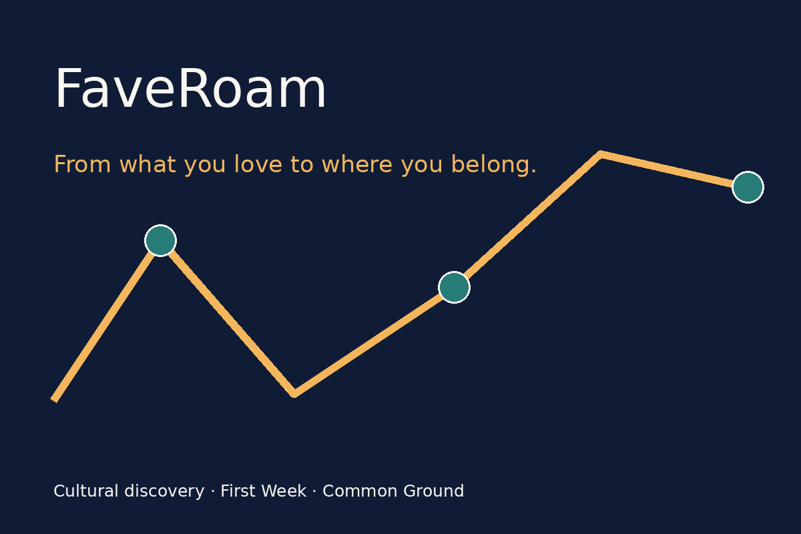
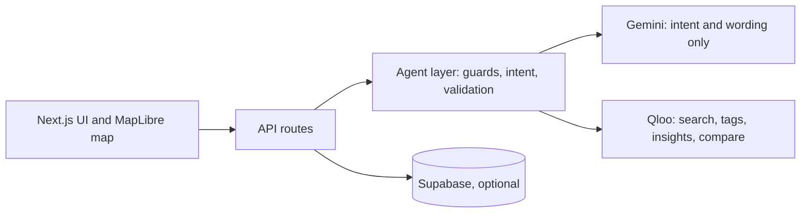
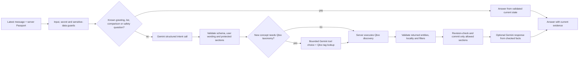

# FaveRoam

**Move anywhere. Keep what moves you.**

FaveRoam is an agent-powered cultural discovery app for people making a new city feel like home. Tell it a film, an artist or a cuisine you already love. It turns those confirmed tastes into places and culture in your destination, a first-week plan, weekly rituals, and common ground with someone you've just met. Suggestions disclose the evidence available; when Qloo returns nothing suitable, the app shows a gap instead of inventing a venue.


**[Live demo](https://my-faveroam-app.cloud.run/)** · [Qloo Agentic Hackathon](https://qloo.devpost.com/) · [Devpost submission copy](docs/DEVPOST_SUBMISSION.md) · [Project guide](docs/PROJECT_GUIDE.md) · [MIT license](LICENSE)



## The problem

A newcomer usually knows what they love but not where those tastes lead in a new city. A generic city guide starts with popularity. A chatbot without cultural retrieval can offer plausible suggestions, but may guess which *Interstellar* or *A.R. Rahman* you meant or give reasons without evidence from the recommended place.

## Our answer

FaveRoam starts from **confirmed cultural interests** and keeps the person in control. Qloo supplies the cultural entities and associations. Gemini helps interpret language. **The server verifies every result before the app shows it.**

## A quick tour

1. Open the **[live demo](https://my-faveroam-app.cloud.run/)** and choose **Try a sample**. It fills a destination and three interests, then asks you to confirm each match.
2. Open **Discover**. Returned places appear on a map. Choose an **Around [venue]** group to filter nearby places, then open a card to see *why it may fit* and the limits of the evidence.
3. Ask: **"Find quieter Indian food within a moderate budget. Keep my movies unchanged."** Then ask **"Make those cheaper."** Expand **What I checked** to see the route, the protected sections and the validation steps.
4. Select a place on the map and plan a day from it, then build a seven-day **First Week**.
5. Open **Common Ground** and enter a second person's interests. Explore shared themes, a first place to try, and something each person can show the other.
6. Sign in with your own account, then download a taste card or create an expiring read-only link that a friend can use to start their own comparison.

## What it does

| Feature | What you get |
|---|---|
| **Confirmed interests** | Qloo returns candidates; you pick the right title or name before anything is used as a taste signal. |
| **Discover and evidence** | Cards for food, coffee, music, film, culture and more, with returned tags and labelled audience associations. |
| **Place map and clusters** | Returned places with real coordinates on a map; nearby venues grouped around a real anchor venue. No invented neighbourhoods. |
| **Ask FaveRoam** | Conversational refinement with budget and cuisine requirements. "Keep my movies unchanged" is enforced by the server. |
| **Vibe Dial** | Choose a direction from themes Qloo actually returned, with a receipt of what changed. |
| **First Week** | Seven editable days built from returned venues. Lock, remove (leaves an open slot), undo, and export to a calendar file. |
| **My Rituals** | Turn a verified discovery into a weekly or fortnightly routine; replace it only by approving a returned alternative. |
| **Common Ground** | Compare two people's confirmed tastes, get one first place to try, grounded conversation starters, and a shared first week where each stop is marked *you*, *partner* or *both*. |
| **Share** | Signed-in users can download a taste card or create an expiring, revocable, read-only link, and manage their links from their account. |
| **Accounts** | Save Passports, plans, First Weeks, rituals and taste profiles, and share. Guests can explore discovery, the map and Common Ground without signing in. |

## Why it is different

| Design choice | Why it matters | Where to look |
|---|---|---|
| **Gemini suggests, the server verifies.** | The model never executes tools or commits changes. A revision check updates the session only if identity, destination and every untouched section are unchanged. | [`src/agent/orchestrator.ts`](src/agent/orchestrator.ts) |
| **Only confirmed tastes are called yours.** | Inputs the app resolves from your wording (a dietary phrase, a dish) are labelled "used from your request", not "your confirmed tastes". | [`src/agent/chat-shortlist.ts`](src/agent/chat-shortlist.ts) |
| **Evidence before explanation.** | Audience associations are labelled as collective patterns, not proof of personal preference. Broader or unverified results carry the same label everywhere. | [`src/qloo/explanation.ts`](src/qloo/explanation.ts) |
| **Gaps instead of guesses.** | Missing categories stay open in plans, and a place is never added without returned evidence. | [`src/passport/first-week.ts`](src/passport/first-week.ts) |
| **Common Ground ranks venues by evidence.** | The first place to try favours a returned shared theme, then signals tying it to both people, and says plainly when nothing connects it. | [`src/passport/common-ground.ts`](src/passport/common-ground.ts) |
| **Share links are built defensively.** | Random 24-byte tokens, a hash used for lookup, 14-day expiry, revocation, five active links per account, and no chat history in a share. The owner's display name appears on the shared page when available. The table is locked to the server's service role by row-level security. | [`src/share/links.ts`](src/share/links.ts) |

## How we use Qloo

| Qloo capability | Used for |
|---|---|
| Entity search and lookup (`/search`, `/entities`) | Resolve and confirm the artists, films, cuisines and places a person names. |
| Tags (`/v2/tags`, `/v2/tags/types`) | Turn a concept such as a cuisine, dish or atmosphere into a Qloo tag. |
| Insights (`/v2/insights/`) | Discovery. `filter.type` is the requested **output type** (for example `urn:entity:place`), while confirmed entities and tags are the input signals. |
| Compare (`/v2/analysis/compare`) | Shared and distinct cultural themes between two people. |
| Trending (`/v2/trending`) and analysis views | Audience context: taste, heatmap and demographic analysis ([`src/qloo/analysis.ts`](src/qloo/analysis.ts)). |

Validated official harness/MCP functions are used where appropriate. See the [Qloo developer guide](https://docs.qloo.com/reference/qloo-llm-hackathon-developer-guide).

This table describes a difference in workflow and evidence. It is not a measured claim that every FaveRoam result beats every LLM answer.

## Architecture



### How one conversation turn works



This is **structured intent plus server-orchestrated retrieval** with a bounded taxonomy tool loop. It is not a fully autonomous multi-agent system: Gemini does not choose arbitrary endpoints, make bookings or commit changes. Schemas, input checks, tool allow-lists, evidence validation, preservation checks and revision checks are the safety boundary, not model temperature. The [project guide](docs/PROJECT_GUIDE.md) documents the details.

## Tech stack

| Layer | Technology |
|---|---|
| App | Next.js 16, React, TypeScript |
| Map | MapLibre GL with CARTO Voyager tiles |
| Cultural data | Qloo API and official harness/MCP |
| Language model | Gemini via `@google/genai` |
| Accounts and storage (optional) | Supabase |
| Hosting | Google Cloud Run |

## Run it locally

Use **Node.js 24+** and npm.

```sh
npm ci
cp .env.example .env.local
npm run dev -- --port 3000
```

Open `http://localhost:3000`. Set these **server-side** values in `.env.local`:

| Setting | Required | Purpose |
|---|---|---|
| `QLOO_API_KEY` | Yes | Live Qloo discovery. Use a hackathon-enabled key. |
| `QLOO_API_BASE_URL` | Yes | `https://hackathon.api.qloo.com` |
| `GEMINI_API_KEY` | Recommended | Native Gemini conversation. Without it the app falls back to deterministic interpretation. |
| `SUPABASE_URL`, `SUPABASE_PUBLISHABLE_KEY`, `SUPABASE_SERVICE_ROLE_KEY` | Optional | Accounts and saved data. Keep the service-role key server-only. |
| `APP_ORIGIN` | Optional | Canonical HTTPS origin for account email redirects. |
| `CARTO_API_KEY` | Optional | Website key for map tiles. Without it the map shows a setup message and a schematic view. |

Never put a provider or service-role secret in a `NEXT_PUBLIC_` variable, a commit, logs or screenshots. The CARTO key is the exception: it is visible to anyone inspecting browser requests, so restrict it to your site's origins in the CARTO dashboard (for example `https://my-faveroam-app.cloud.run`, and localhost for local testing only).

For accounts, create a Supabase project, enable email/password sign-in, set the `/auth/callback` redirect URLs, and run [`db-scripts/setup.sql`](db-scripts/setup.sql) manually in the SQL Editor. **It is a destructive reset** of app-owned data (Auth users are kept), so never run it from startup or CI. After running it, start a New Passport.

## Verify

```sh
npm run check:docs
npm test
npm run typecheck
npm run build
npm run smoke:production
```

These checks use local fixtures and a production smoke test; they do not certify live Qloo, Gemini, map-tile or email behaviour. Opt-in live checks are `npm run verify:qloo`, `npm run verify:gemini`, `npm run verify:accuracy` and `npm run verify:relevance`. They consume provider quota.

The app listens on the host-provided `PORT` and exposes `/api/health` for readiness. GitHub Actions checks the configured branches; verify the latest workflow run before deploying.

## Honest boundaries

FaveRoam does not book venues, verify opening hours or showtimes, guarantee travel times, or certify dietary or medical safety. Some Qloo entities have no image, rating or venue details, and the app does not infer missing facts. Audience associations and geographic affinity describe aggregate patterns, not an individual. Live coverage varies by city and interest.

## Repository layout

| Path | Contents |
|---|---|
| `app/` | Next.js pages, API routes and React components |
| `src/agent/` | Conversation orchestration, guards, intent, validation and ranking |
| `src/qloo/` | Qloo client, query planning, Compare, analysis and explanations |
| `src/passport/` | First Week, Common Ground, Vibe Dial, area clusters and day planning |
| `src/share/`, `src/account/` | Share links, accounts, saved plans and rituals |
| `db-scripts/` | Database schema and policies |
| `tests/`, `scripts/` | Automated tests and verification scripts |
| `docs/` | One maintained project guide |

## Acknowledgements and license

Built for the [Qloo Agentic Hackathon](https://qloo.devpost.com/) with Qloo's cultural API, Google Gemini and Google Cloud Run. Map data © OpenStreetMap contributors, © CARTO. Released under the [MIT license](LICENSE).
