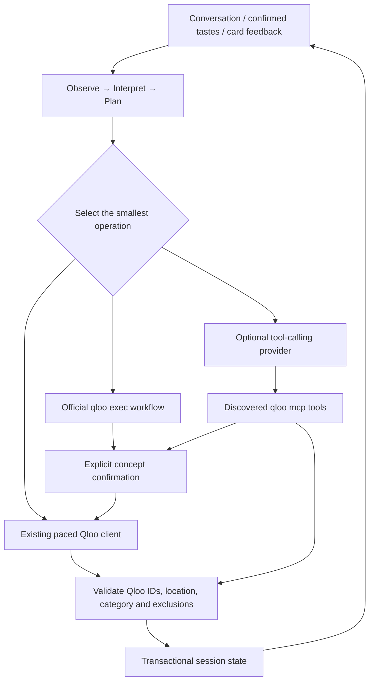

# TastePassport Agent — Phase 3

Current conversation review and execution boundaries: [CONVERSATION_ARCHITECTURE_REVIEW.md](CONVERSATION_ARCHITECTURE_REVIEW.md).

Current product evidence and familiarity strategies: [CULTURAL_ONBOARDING.md](CULTURAL_ONBOARDING.md).

The subsequent shared-state/guided refinement upgrade is documented in [SESSION_RELIABILITY.md](SESSION_RELIABILITY.md). That document supersedes the earlier provider messaging, hidden-section handling and one-shot empty-result behavior described below.

## Architecture

One orchestration agent evolves the existing passport. It does not delegate to a swarm or treat generated text as discovery evidence.

## Deterministic Qloo path

The proven Node client still handles entity search, strict destination constraints, fixed category retrieval, exclusions and shortlist queries. The legacy `/api/resolve` remains available. The workspace uses `/api/agent/resolve`, which routes named tastes to that same client and recognized concepts to an official tag workflow. Candidates retain real IDs and metadata; every match requires user confirmation.

Initial passports preserve the original two insights operations (places and artists), now support confirmed tag signals, and initialize agent state. Category updates query only requested sections. `filter.location.query` and `filter.location.radius=0` constrain places. Music is still a contextual artist recommendation, not a local concert/event claim.

Known parameters are documented Qloo fields: `filter.tags`, `operator.filter.tags`, `filter.exclude.entities`, `filter.results.entities`, `filter.price_level.max`, `filter.popularity.max`, entity/tag signals and locality. The physical restaurant genre URN was observed in prior real Qloo responses. The Indian cuisine URN was obtained from the live official tag workflow, not invented.

## Official workflow and MCP paths

Installed and pinned `@qloo/qloo-harness@0.1.26`. Inspected its published README, generated workflow schemas, canonical `dist/mcp.js` adapter and executor before implementing calls. The repository listed by the npm package (`qloo/agentic-qloo`) was inaccessible to this environment; the separate source starter could not be fetched. The published adapter itself provides the authoritative working stdio integration used here.

Runtime MCP `tools/list` confirmed:

- `qloo_capabilities`
- `qloo_recommend`, `qloo_rank`, `qloo_describe`, `qloo_where_popular`
- `qloo_compare_audiences`, `qloo_entity_tags`, `qloo_audience_demographics`
- `qloo_trends`, `qloo_find_tags`

Only **qloo_find_tags** and **qloo_rank** are exposed to this app's optional model. Other advertised operations are not claimed as implemented product features. The canonical workflow contract is discoverable at `qloo://contracts/workflows`.

| Operation | Application use | Transport / validation |
| --- | --- | --- |
| `find_tags` / `qloo_find_tags` | Cuisine, quietness or bookstore concepts; pauses for explicit choice | `qloo exec` when operation is already known; `qloo mcp` when selected dynamically by configured model |
| `qloo_rank` | Model-selected shortlist ranking | MCP; options/signals/location are supplied from trusted app state; returned IDs must belong to the existing shortlist |
| Entity search / insights | Known entity lookup and fixed destination/category discovery | Existing deterministic client |

The model sees **actual discovered tool schemas**. Unsupported tool names fail closed. `qloo exec` and `qloo mcp` share the normalized workflow result contract (`schema_version=1.0-preview.1`); exec's underlying execution transport is direct, while MCP reports `execution.transport=mcp`. `qloo api` raw-response CLI is not used. MCP is a dynamic-selection interface, not a better recommendation model.

Node stdio subprocesses are technically feasible in this environment. They receive only the Qloo credential and required proxy/trust/runtime settings, never model credentials or account/session IDs. App `QLOO_API_BASE_URL` maps to harness `QLOO_BASE_URL` and exact `QLOO_TRUSTED_BASE_URL`. No key is written via `qloo config`. Harness-private files use a dedicated `/tmp` root; no raw tool output is logged by the app.

## Provider abstraction

`ModelProvider` supplies intent interpretation and bounded tool selection. The included implementation uses an explicitly configured OpenAI-compatible tool-calling endpoint:

- `AGENT_MODEL_API_KEY` — secure server credential
- `AGENT_MODEL_BASE_URL` — HTTPS API base, normally ending in `/v1`
- `AGENT_MODEL_NAME` — provider-selected tool-capable model

No endpoint or model is hard-coded. Without all three, model/MCP conversation is visibly unavailable while supported deterministic interpretation and refinement work. Provider-generated prose, entity names, addresses, metrics and extra intent fields are never used to construct recommendation cards. Model content/hidden reasoning is not displayed. Providers with other wire formats require another implementation of the same interface.

## Agent state

Bounded, in-memory sessions contain destination, confirmed inputs, resolved tags, global/category constraints, current and previous cards, feedback, current intent, pending tag choices, revision and expiry. Session IDs are random capability tokens; they are never sent to Qloo. No database or user identity is introduced. Maximum 100 sessions, 30-minute expiry, 200 previous cards, 100 feedback records and 10 active tags.

Turns use a working copy and per-session lock. Revision checks reject overlapping/stale requests. Failed operations retain previous recommendations. Successful changes replace only affected sections; unaffected cards and Taste DNA stay unchanged. A pending concept choice retains the passport until the user selects an actual returned tag.

## Tool selection and feedback

Observe → interpret → choose target sections/constraints → select workflow → execute under budget → validate → commit section changes → respond from evidence.

- Named seed: native search; cultural concept: validated tag workflow.
- Accept card: record a cultural anchor without a Qloo request; toggle again clears it.
- Reject card: require a reason, record rejection, carry its ID as an exclusion and refresh that category only.
- Rank request: rank an existing shortlist, with no new model-generated entities.
- Cuisine/quietness/bookstore refinement: reuse confirmed relevant tags or return fresh Qloo tag choices.
- Hide section: local state update; no Qloo request. Mixed requests can hide coffee while refreshing other requested sections.
- Liked café: subsequent coffee retrieval can include the accepted Qloo entity as a cultural signal.

Reason handling is explicit: tourist-like metadata is excluded; mainstream refinement uses the documented aggregate popularity maximum 0.9; affordable requests use price level maximum 2. Those cutoffs are application policies, not fabricated user confidence or prices. Quiet tags do not establish live crowd levels. Wrong-atmosphere/Not-interested feedback excludes the rejected entity and seeks new grounded candidates without claiming to measure an unsupported property.

## Validation and provenance

Place validation preserves existing service exclusions, additionally requires category/genre evidence and returned matching city/metro metadata. A landmark's “nearby food trucks” tag is not enough to classify it as Eat. Artist results must actually be artist entities. Rejected IDs are excluded. Shortlist results can update only known IDs and Qloo-returned numeric affinity; generated entity/address data cannot enter a card.

Cards carry names of inputs actually submitted for their section. Concept filters, accepted anchors and original signals can differ by category; individual contribution is not invented. The translation visualization represents the shared profile pool, not a causal one-to-one link.

## Activity UI

The turn endpoint streams NDJSON execution events. The existing activity feed shows safe labels for interpretation, concept lookup, ranking and section update success/failure. It never exposes prompts, headers, secrets, raw traces or chain-of-thought. Current cards remain visible while affected sections update; only changed section keys reveal again. Feedback and tag selection use accessible native dialogs.

## Guardrails and reliability

- At most **four logical Qloo tool operations per refinement turn**; initial 3–5 seed resolution is separately capped at five.
- 90-second turn deadline, 25-second workflow process deadline, bounded output and SDK calls; model requests time out after 20 seconds and selection is limited to two Qloo workflows.
- Repeated identical tool calls are prevented; repeated concept choices are deduplicated.
- Shared paced queue serializes native and workflow operations. Successful identical workflow/native requests use bounded five-minute caches.
- Existing native requests retain bounded exponential/Retry-After 429 retries. The official harness client already has three bounded attempts for retryable statuses and Retry-After handling, so the app adds no outer retry loop.
- Logical operation limits are not physical HTTP counts: a workflow may resolve inputs and retry internally. Deadline cancellation is linked into queued/native and workflow requests; late results are not committed.
- Common personal identifiers/contact data are rejected before cultural input is sent. Qloo receives selected cultural entity/tag IDs and product query fields, not account/device/session identifiers. This is a prototype validation boundary, not comprehensive PII detection.

## Failure behavior

Missing/failed provider → labelled deterministic refinement. MCP concept failure → current passport retained and clarification remains available. MCP rank failure → at most one guarded deterministic shortlist fallback. Native 429/error/empty results → previous affected section retained; unrelated sections remain available. Invalid outputs never become mock recommendations. Session expiry asks for rebuilding while preserving the client taste draft.

## Verification

- Dependency installation, type checking, tests and production build were executed; existing Qloo/feasibility/UI tests are preserved.
- Runtime tool discovery and canonical resource inspection succeeded.
- A controlled live MCP `qloo_find_tags` call returned five real Indian-cuisine concepts, status ok, normalized schema 1.0-preview.1, transport mcp.
- Controlled application integration: NYC + A.R. Rahman + Interstellar + explicitly chosen returned Indian cuisine tag. The specified conversational request refreshed only Eat with 14 Qloo-backed results, kept destination NYC, and preserved Music byte-for-byte. A subsequent Not My Vibe exclusion produced real replacement results without destroying Music.
- Initial verification caught an onboarding parser bug and a wrong assumption that cuisine tags always have place/restaurant URNs. Both were corrected against tests and actual returned `urn:tag:cuisine:qloo:indian` data, then the controlled scenario passed.
- No model credential is configured, so live model-driven intent/tool choice and live MCP shortlist ranking remain **unrun**. Their behavior/fallbacks are tested with isolated mocks; the real MCP tag transport and deterministic feedback/concierge paths were tested live.

## Limitations and deployment boundary

Supported deterministic interpretation is deliberately narrow; genuine open-ended model conversation requires provider configuration. Nuanced preference reversal and real-time availability/crowding are not guaranteed. Metadata-backed tags still need quality evaluation and may represent mixed businesses. There is no event scheduling, booking, map, itinerary, identity or persistent storage. Child-process MCP/exec requires a full Node runtime and installed harness; edge/serverless targets without process execution need another adapter. Session state and caches are process-local and disappear on restart.

Before deployment: configure and live-test a tool-capable model, validate shortlist ranking and cultural category precision, add shared quotas/abuse controls and durable session strategy if needed, review privacy/response-data licensing, and validate cancellation behavior under deployment load. No deployment was attempted.

## Completion record

Final validation: **36 tests passed**, including 21 agent-focused tests plus all 15 existing client/passport/UI tests. `npm run typecheck` and `npm run build` passed. The production browser flow confirmed three tastes, generated 39 initial cards, then successfully refined Eat and rejected/replaced a dining card while preserving Music unchanged. Safe streamed events appeared in the activity UI; the mobile 390px check had no horizontal overflow. The optional model mode was not represented as active during these live tests.

Credential-value scans passed across commit-eligible source, browser bundles, harness-private logs and private integration evidence. `.env.example` contains empty credentials only; the existing secret-file ignore rules remain intact. No key was modified, printed, logged or written. Existing feasibility documentation and tests remain unchanged. No deployment, authentication, database, booking, maps or multi-agent runtime was introduced.

Turn deadlines now propagate an abort signal into native discovery and workflow calls. Expired queued work cannot start a later Qloo request; existing native retry/timeout policies otherwise remain unchanged. Provider requests retain their own bounded 20-second timeout. Activity distinguishes intent interpretation from Qloo resolution, and a fixed status strip keeps current execution visible while the user reviews cards.
