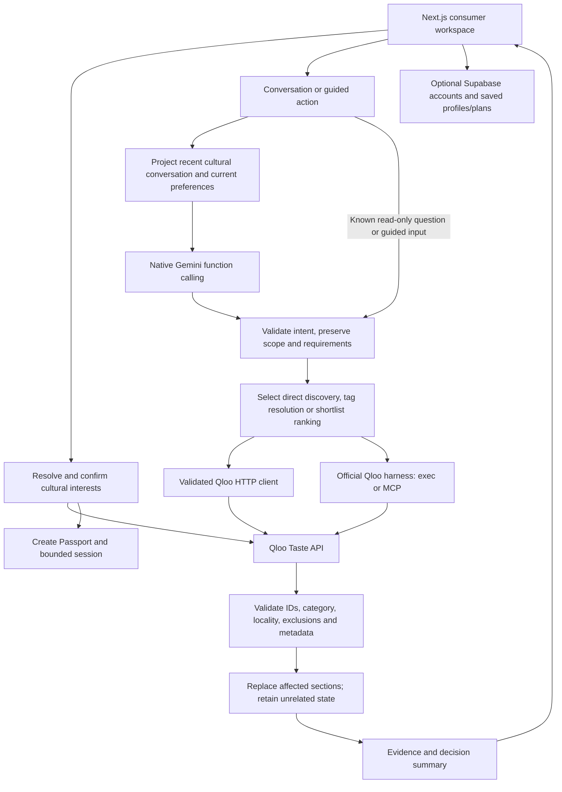

# Agent architecture and implementation

TastePassport implements a **single stateful, tool-using agent with bounded orchestration**. Gemini supplies structured interpretation and supported dynamic tool choices; Qloo supplies cultural discovery; server code owns scope, state mutation and result validation.

## System view

## Boundaries and module ownership

| Module | Responsibility |
|---|---|
| `app/page.tsx`, `app/components/` | Consumer state projections, rendering and typed actions |
| `app/api/agent/resolve` and `src/passport/service.ts` | Real candidate resolution, signed choices and initial Passport |
| `app/api/agent/turn` | Validate one action, stream activity/result messages and enforce cancellation |
| `src/agent/context.ts` | Whitelist cultural context; omit account records, secrets and raw responses |
| `src/agent/provider.ts` | Native Google SDK, function declarations, bounded responses and compatible-provider fallback configuration |
| `src/agent/orchestrator.ts` | Interpret, apply scope policy, resolve requirements, execute and commit requested updates |
| `src/agent/scope.ts`, `session.ts`, `store.ts` | Preservation rules, canonical normalization, session lifecycle and revision locking |
| `src/agent/guard.ts` | Tool budget, duplicate-call prevention, timeout and cancellation |
| `src/agent/harness.ts` | Actual official MCP tool discovery/calls and exec workflow transport |
| `src/agent/runtime.ts`, `strategy.ts` | Category retrieval, query pools and familiarity strategies |
| `src/qloo/` | Parameter planning, HTTP transport, normalization, numeric/result checks and evidence helpers |
| `src/agent/answers.ts`, `decision-summary.ts` | Grounded read-only answers and before/after action receipts |
| `src/account/`, `supabase/` | Validated persistence, ownership checks, profiles, plans and Auth integration |

## A conversation turn

1. Validate a single typed action and obtain the current session revision.
2. Answer recognized read-only questions from existing evidence without regenerating recommendations. Guided controls bypass model interpretation.
3. For conversational edits, give native Gemini the latest message, up to eight recent cultural messages and a whitelist of current Passport preferences. Prior requests are context, not instructions to replay.
4. Validate the returned intent. Explicit preservation instructions, typed scope and server state take precedence over unsupported model guesses. Ambiguous multi-section follow-ups ask for a target.
5. Patch only requested preferences. Calculate relative budget changes from server state; “cheaper” cannot raise an existing cap. Ordinary edits do not silently change discovery mode.
6. Resolve genuinely new concepts through actual Qloo taxonomy. Recognized dietary options and unique supported dish matches can apply directly; unresolved identity remains a confirmation step.
7. Run the smallest supported operation under execution limits. Validate actual returned results before replacing affected sections.
8. Return the outcome, applied price/rating changes, retained requirements and a supported before/after listing example. No fabricated discovery or model-authored data enters cards.

## What is model-driven and what is deterministic?

| Model-driven | Server-controlled |
|---|---|
| Semantic intent and reference interpretation | Which changes are permitted |
| Requested domain, constraints and partial query intent | Validation of IDs, fields, scope and explicit requirements |
| Supported dynamic `qloo_find_tags` / `qloo_rank` selection | Executable tool allowlist, query arguments, budgets and result acceptance |
| Selection among supplied explanation facts where used | Factual source material, local read-only answers and decision receipts |

Known queries do not require a model-selected tool on every turn. The application does not implement an unrestricted autonomous loop in which the model repeatedly replans against every tool response until an arbitrary goal is achieved. MCP is a tool transport, not evidence of multiple agents.

## State, memory and persistence

Canonical session state includes confirmed interests, city, category tags/concepts, numeric preferences, discovery modes, feedback, cards, pending resolution and bounded history. Conversation and guided controls share it.

Guest sessions are process-local, revision-checked and expire after inactivity. Requests for the same session are locked to prevent overlap. Restarting the service loses active guest sessions. Saved Supabase snapshots can restore persisted work; they do not make an expired active session valid. Use a single replica for the current deployment unless shared session storage or affinity is added.

**Reset conversation** clears chat and refinement context, including refinement filters, while preserving the destination, confirmed tastes, returned cards and saved feedback. **New Passport** clears the active Passport. These reset semantics are distinct from a normal follow-up, which preserves omitted preferences.

## Requirements and recovery

- A category-style change preserves explicitly refined cuisine, diet, numeric limits and unrelated categories. Explore may broaden eligible soft profile signals; it must not turn a dietary requirement into an optional signal.
- Missing or failed model/tool calls retain guided refinement. Fallback is labelled; its success is not represented as successful native model execution.
- Sparse retrieval can broaden taste signals while keeping explicit requirements. Existing results remain when no acceptable replacement is available.
- Qloo contributions describe returned audience/taste relationships. They do not establish shared film plot, genre or guaranteed individual enjoyment.
- The planner retrieves actual place entities for cinema/nightlife and does not substitute audience-only film/artist recommendations for physical stops.

## Security and observability

Provider and service credentials stay server-side. Inputs and saved snapshots are validated; account operations enforce ownership. The model context is a whitelist projection rather than a serialized session/account record. Contact information, credentials and oversized history are omitted. Native roles are grouped safely after guided-only messages; context sharing is restricted to native Gemini, preserving the optional compatible adapter's prior latest-message behavior.

Production logs contain allowlisted request IDs, event names, counts, statuses and timing. They exclude prompts, transcripts, headers, credentials, account tokens and raw Qloo responses. The private inspector is development-only. See [debugging](FLOW_AND_DEBUGGING.md).

## Verification

The regression suite covers scope preservation, contextual interpretation contracts, strict numeric metadata, dietary taxonomy, style changes, provider function protocols, role grouping, pending state, cancellation, feedback and account guards. Live provider probes and real browser journeys are separate from mocked tests. Consult the [release checklist](RELEASE_CHECKLIST.md) for the actual recorded results and unresolved deployment/account checks.
