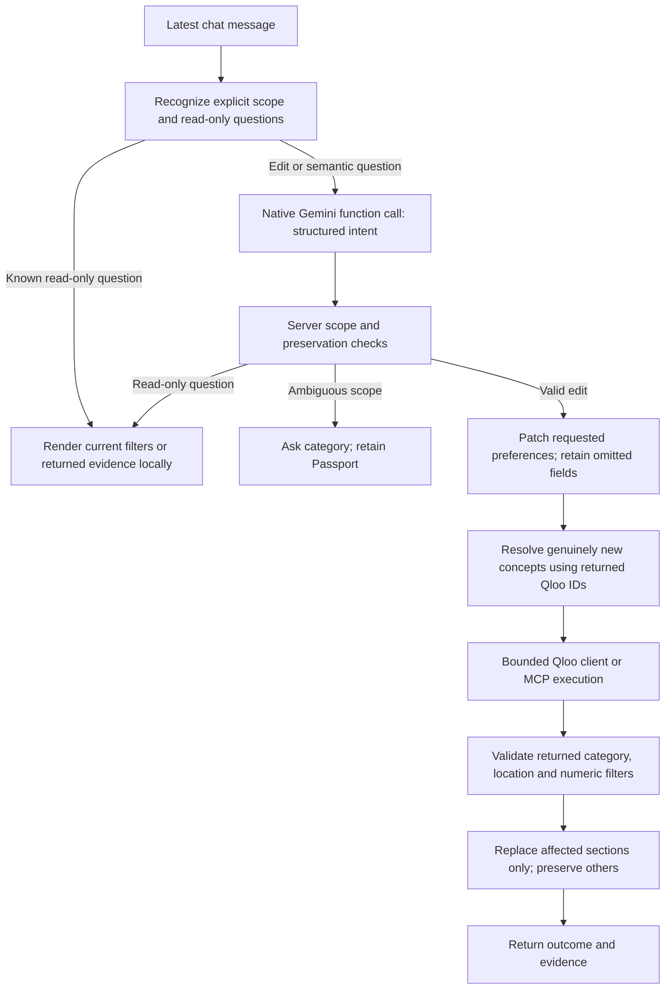

# Ask TastePassport conversation review

## Findings

The original interface used native Gemini function calling but sent only the latest message and destination for interpretation. That gap is now fixed following explicit user approval: native Gemini receives up to eight recent cultural messages and a whitelist of current Passport preferences. Tool selection receives the same bounded context alongside its cultural shortlist.

The review identified several concrete failures beyond model availability:

1. Read-only questions could fall through to command guidance or become mutations.
2. A follow-up without a named section could default to Dining or the first previous section.
3. A model could guess Dining for a Coffee follow-up, invent a new “budget-friendly” concept requiring disambiguation, or supply a higher absolute price cap for “cheaper.”
4. The original review identified missing conversation context. The user subsequently approved the specific transfer to Gemini; bounded context is now enabled.

## Current execution boundary

Gemini supplies a constrained intent rather than recommendation facts. The server owns Qloo IDs, execution budgets, mutations, numerical relative updates and preserved categories. Known read-only questions require no external call. Semantic questions can select a fixed question type through Gemini, then receive an answer rendered from server evidence; the model does not invent an explanation.

## Changes in this pass

- Read-only capabilities, active-filter and recommendation-explanation answers. They preserve cards, preferences and any pending confirmation.
- Local scope inheritance for ordinary pronoun/relative follow-ups; explicit category changes still take precedence. Multi-section ambiguity asks a question rather than choosing the first section.
- No default to Dining when several visible sections plausibly match the request. A venue-only modifier can target the sole visible venue section.
- A relative modifier does not create a new cuisine/taxonomy lookup. Existing cuisine and diet are retained.
- “Cheaper” is calculated from the current server cap, with a floor of category 1. A model-generated absolute cap cannot increase it.
- The deterministic interpreter uses the current Passport city rather than a New York default.

## Validation and limits

`tests/conversation-architecture.test.ts` exercises read-only answers, pending-state retention, explicit edits with explanations, ambiguous scope, native intent validation, Coffee scope protection and relative budget changes. `scripts/verify-conversation-journey.ts` exercises real Gemini/Qloo refinement, an ordinary follow-up, protected categories, and local read-only answers using the approved bounded cultural context.

Native Gemini now receives up to eight recent cultural messages with their user/model roles plus current destination, confirmed cultural taste names, last sections and scoped preferences/requirements. The projection omits session IDs, account records, credentials, raw API payloads, contact information and oversized text. It sends no full-session serialization and logs no transcript. The optional compatibility adapter retains its previous latest-message payload; this Gemini approval does not enable history sharing with another provider. Server-side scope and mutation guards remain authoritative.

Other existing limits remain: content recommendations are not local showtimes; venue tags do not certify dietary safety; opening hours, transport times, prices and reservations require checking. If strict constraints produce no eligible results, recovery must preserve prior recommendations rather than silently relaxing requirements.

Final regression checks: 200 tests passed. The live native sequence completed vegetarian dining and a cheaper follow-up without pending disambiguation, preserved Music/Movies and answered explanation/filter questions without Qloo mutation calls. Counts are observations of live data, not guaranteed future inventory. Ordinary budget updates also preserve discovery mode when no mode change was requested.

The production browser scenario also passed across consecutive messages: vegetarian dining, explanation, saved filters, cheaper follow-up, then cinema planning. The follow-up returned 20 dining cards, all with a known price category at most 1; other content sections remained unchanged. The selected dinner survived cinema retrieval. Desktop/mobile containment and production smoke passed. No claim is made that the Railway deployment has been checked.

## Approved native context acceptance

Run `node --use-env-proxy --conditions=react-server --import tsx scripts/verify-conversation-context.ts` for real native Gemini/Qloo reference resolution. It sets a dining rating minimum, then asks “Raise that minimum to 4.6” and “Actually make it 4.7 instead,” verifying the intended rating field, preserved diet/cuisine/budget, protected Music/Movies and actual eligible returned dining results.

Approved-context verification: 204 tests, production build and production smoke passed. Live native Gemini/Qloo returned five eligible dining results at rating minimum 4.6 and three at 4.7 through the two reference-only follow-ups; budget, vegetarian options, Indian cuisine, Music and Movies were retained. Counts reflect that run. Tests additionally cover credential/contact omission, eight-message bounds, user/model role grouping after guided actions, and absence of history in the compatibility adapter payload.
