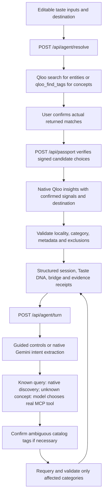

# TastePassport flow and backend debugging

## What the Toronto sample actually does

The Bengaluru → Toronto button in `app/page.tsx` fills editable form inputs: destination Toronto and taste queries A.R. Rahman, Interstellar, Indian cuisine, specialty coffee, independent culture. The persona story is demo copy. It contains no canned restaurant, artist or venue recommendation, no sample Qloo response, and no identity-based recommendation rule. You can change the city or queries, or use your own inputs.

Results are actual Qloo responses, optionally served from the private five-minute cache. Names/IDs must be resolved and confirmed before becoming Taste DNA. A response can be empty or ambiguous. The app does not replace failures with fake recommendations. The confirmed profile, destination and selected constraints drive discovery; Gemini interprets intent and selects tools rather than inventing Qloo discoveries.

## Code path

- `app/page.tsx`: form/sample button, match confirmation, guided and conversational controls.
- `app/api/agent/resolve/route.ts` → `src/agent/runtime.ts`: resolve input queries through actual Qloo search/workflows.
- `src/passport/service.ts`: signed candidate validation and initial Qloo-backed Passport creation.
- `src/agent/store.ts` / `session.ts`: bounded shared state, revision locking and reset semantics.
- `src/agent/orchestrator.ts`: intent, category updates, feedback, concept confirmation and bounded fallback.
- `src/agent/provider.ts`: native Google SDK interpretation/function choice and optional tool-free comparison.
- `src/agent/harness.ts`: official Qloo MCP/exec invocation.
- `src/agent/runtime.ts` / `strategy.ts`: Familiar/direct, Explore/adjacent, Balanced/combined retrieval.
- `src/qloo/client.ts` / `transport.ts`: actual Qloo HTTP requests, pacing, private cache and bounded 429 retries.
- `src/agent/validation.ts` / `src/passport/evidence.ts`: real result validation and receipts.

## Enable and read backend logs

Add `AGENT_DEBUG=1` to ignored local `.env.local` or cloud environment settings, then restart `npm run dev -- --port 3000`. Read the terminal running Next.js, or your deployment's server logs. Cloud configuration and local environment files are separate. The acceptance script enables safe debug logs by default unless explicitly disabled.

Every HTTP request receives a random `requestTrace` shared across async operations. Each Gemini/harness operation may also have its own `trace`. These IDs are not session tokens. Filter by `requestTrace` to follow one request even when other users are active.

| Event | What it proves |
| --- | --- |
| `api.started` | Backend request entered a specific route |
| `resolution.started/candidates/completed` | Seed count, per-seed candidate count, overall resolution count |
| `qloo.request/response/entities` | Actual native HTTP attempt, HTTP status, parsed entity count |
| `qloo.cache_hit` | Existing private cache answered; no fresh upstream request needed |
| `qloo.retry` | A bounded 429 retry, with attempt and delay |
| `passport.started/pool/completed` | Confirmed signal count, upstream pool count, valid retained results |
| `gemini.request/tool_selected/result/failed` | Native model attempt, validated function choice and outcome |
| `qloo.invoked/result/failed` | Official workflow invocation, MCP or exec transport and returned count |
| `agent.started/intent` | Input action, interpreted intent kind and targeted categories |
| `discovery.started/pool/completed/failed` | Target category, strategy/pool, exclusions and returned/kept counts |
| `feedback.recorded` | Category-specific acceptance, rejection or clearing |
| `agent.fallback` | Provider/tool interpretation fell back to guided/deterministic behavior |
| `agent.completed` | Committed turn outcome, changed categories and total card count |
| `session.reset` | Conversation-only reset or New Passport invalidation |
| `api.completed/failed` | Route status and elapsed time |

For streaming turns, HTTP `api.completed` may precede the final turn outcome; look for `agent.completed` or subsequent `api.failed`. `qloo.invoked` indicates workflow invocation, which may use the existing cache; only a cache miss performs fresh upstream work. Counts can decrease after validation; incorrect city/category or rejected entities do not become cards.

Logs deliberately omit raw seeds/messages, keys, headers, URLs with query strings, signed confirmation tokens, session IDs, model/Qloo bodies and raw exceptions. They expose safe fixed names, counts, status codes, strategies and timings. Inspect real recommendation names/IDs in the UI's **View Qloo evidence**, not raw server-response dumps. Debug logging is opt-in; set `AGENT_DEBUG=0` to disable.

## Hackathon walkthrough

1. New Passport. Use Toronto with explicitly confirmed A.R. Rahman, Interstellar (2014), Indian cuisine, or enter your own supported city and tastes.
2. Observe resolution/candidate logs, then confirm matches. The story is sample input; these matches come from Qloo.
3. Build the Passport. Inspect DNA, bridge and **View Qloo evidence**. Match native response counts to retained card counts in logs.
4. Change Eat from Familiar to Explore/Balanced; observe strategy pools and preservation of other categories.
5. Ask “Tonight I want Indian food, quiet atmosphere, and nothing too touristy.” Follow request/intent/concept/discovery logs; confirm catalog matches when requested.
6. Reject an Eat card via Not My Vibe → Too mainstream. Logs show feedback scope and exclusion count, followed by Qloo-backed replanning.
7. Ask “Forget food. Show me something cultural.” Eat hides; Culture changes. Museum is a verified catalog starting tag, not an invented personal taste.
8. Ask for independent contemporary art connected to film tastes. Gemini may dynamically select `qloo_find_tags` through MCP; returned ambiguous tags require your confirmation.
9. Run the exact-request model-only comparison when available. That baseline uses model knowledge without Qloo tools and is explicitly labeled unverified.
10. Reset conversation preserves discoveries. New Passport clears all state.

Real results vary by Qloo coverage, metadata, cache and quotas. Quiet tags do not guarantee current crowds; Music is audience context, not a concert schedule. No fabricated score/address or substitute result is supplied when a service fails.

## Live verification of these logs

The production-server walkthrough on 2026-10-14 passed with real Qloo: three confirmed tastes, 35 initial cards, 11 Explore dining cards, rejected-ID exclusion with Music preserved, 12 Culture cards, and both resets. A separate real conversational HTTP turn targeted Culture; native Gemini selected `qloo_find_tags`, actual MCP returned five tags, and the UI response required tag confirmation. The Gemini and MCP events shared one `requestTrace`. No fixture or generated recommendation substituted for Qloo.

The run recorded 109 metadata events across 11 HTTP traces in ignored `.spike-output/backend-debug.log`; private summary is `.spike-output/logging-flow-summary.json`. Known active credentials did not occur in the captured log. Typecheck, 85 tests and production build passed. These counts describe that run; live coverage may change.
