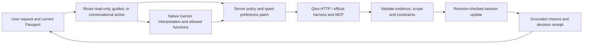

# TastePassport AI — project guide

This is the single reference for the product, Qloo integration, agent design, development, deployment, demo, and submission. The [root README](../README.md) is the short entry point for judges.

## Product and customer journey

Moving cities changes daily routines, but a generic city guide starts from popularity rather than the music, films, food, and other culture a newcomer already loves. TastePassport lets a person bring one to five confirmed interests to a supported destination, discover Qloo-returned places and cultural entities, adapt a Passport through conversation, and turn choices into an outing. Discovery is available to guests.

1. Pick a destination and one to five interests. An optional home city labels the Passport cover; it does not fetch origin-city recommendations or infer a background.
2. Confirm ambiguous named entities. Taxonomy concepts such as cuisine and dietary options use returned Qloo tags rather than invented identifiers.
3. Choose discovery categories. The application requests output entity types appropriate to each category, then validates and ranks returned candidates. Place cards can contain available address, image, business rating, and price metadata. Cultural content is not presented as a local event.
4. Refine one or more sections with Ask TastePassport or guided controls. Explicit constraints and untouched categories remain intact. My Vibe saves liked cards within the Passport; rejected cards guide future relevant retrieval.
5. Compare confirmed profiles through Together. Qloo Compare returns shared cultural associations that inform joint discovery; a match is not a claim of personal compatibility.
6. Build an outing from actual place options, select a date and suggested local times, reorder stops without replacing venues, and swap a stop deliberately. The planner does not book or verify hours, routes, or showtimes.
7. Optionally sign in. Named taste profiles can be reused in another city; saved Passports retain the current discoveries and My Vibe; upcoming plans are separate. An already-saved active Passport updates after successful edits. A fresh Passport in the same city does not overwrite an older saved one until explicitly saved or reopened.

The default demo journey is Bengaluru → Toronto with A.R. Rahman, *Interstellar*, and Indian cuisine. Confirm the exact artist and film; then ask for cheaper vegetarian Indian food while keeping Music and Movies unchanged. Follow with “make those cheaper,” inspect the actual decision receipt, and plan dinner plus a cinema. Use only results returned by the live app when recording; change the script if a provider returns different choices.

## Why Qloo is essential

Gemini interprets requests and writes grounded replies. Qloo supplies real cultural entities, associations, shared tastes, and discovery candidates. The application does not ask Gemini to manufacture restaurant names or a recommendation catalogue. A generic LLM may suggest city ideas, but it cannot supply the Qloo-returned entity IDs, query provenance, contributor evidence, or Compare result used in this workflow.

The hackathon [developer guide](https://docs.qloo.com/reference/qloo-llm-hackathon-developer-guide) describes the hackathon host `https://hackathon.api.qloo.com`. The server sends `X-Api-Key` from `QLOO_API_KEY`; credentials and raw provider responses never belong in the public repository. The main operations are:

| Qloo operation | Use in TastePassport |
|---|---|
| `/search` and entity details | Resolve named inputs and enrich returned entities before identity confirmation. |
| `/v2/tags` and `/v2/tags/types` | Resolve supported cuisine, dietary, dish, ambience, and venue concepts; the latter also supports diagnostics. |
| `/v2/insights/` | Retrieve real entities from confirmed tastes, the requested output type, locality and supported filters. |
| `/v2/analysis/compare` | Return shared associations for Together; both confirmed profiles inform follow-up discovery. |
| Special tag, geographic-affinity, and aggregate-demographic Insights | Supply optional cultural themes and area context where usable evidence exists. They are not a probability that an individual likes something. |
| Official harness/MCP (`qloo_find_tags`, `qloo_rank`) | Execute validated model-selected taxonomy lookup and eligible shortlist ranking. |

`filter.type` selects the **output** entity domain. Normal entity output types are `artist`, `book`, `brand`, `destination`, `movie`, `person`, `place`, `podcast`, `tv_show`, and `video_game`, prefixed by `urn:entity:`. Input tastes may come from different domains. Dining, cafés, and cinemas are place activities distinguished by taxonomy, not separate entity types. Music cards represent artist discovery rather than verified local concerts. A recorded hackathon-host compatibility case maps the documented `urn:entity:video_game` to the wire spelling `urn:entity:videogame` at the HTTP boundary.

`src/qloo/query-plan.ts` allowlists parameters by output type. `src/qloo/verify-result.ts` and the agent validate returned identity, locality, exclusions, and observable numeric limits. Missing price or rating metadata does not satisfy a strict maximum or minimum. Place geography differs from content audience geography; neither proves travel time or live event availability. Cuisine and dietary requirements remain conjunctive. “Vegetarian options” is not evidence of allergen or medical safety.

Cards retain available Qloo metadata, query inputs, and returned contribution evidence. Audience associations are explained as such; they do not prove that an artist caused someone to like a particular venue or that two films share a plot. Explanations state when only collective evidence is available. Affinity values are not presented as universal match probabilities. Entity image URLs come from Qloo when available; the interface falls back visibly when an image cannot load. Original decorative assets are separate from recommendation evidence.

## Agent architecture

TastePassport is one stateful agent with bounded tool use. A Next.js API route owns the turn; Gemini uses the native `@google/genai` SDK with Vertex AI Express Mode; server policy owns authorization and state changes.



- `app/page.tsx` and `app/components/` project the current Passport and provide typed actions. `app/api/agent/turn` streams bounded turn events. `src/agent/orchestrator.ts` routes, validates, executes, and commits. `src/qloo/` plans and checks provider requests/results. `src/account/` owns authentication and account persistence.
- The native model sees the latest request, current cultural preferences, a compact summary of validated decisions, and up to four recent cultural messages under a 2,400-character cap. Account records, API keys, raw provider payloads, and an unbounded transcript are excluded. Current requests and explicit requirements outrank earlier conversation.
- Recognized read-only questions use existing evidence without regenerating cards. Guided controls can act without a model call. Conversational requests use Gemini for semantic intent; supported dynamic workflows can select Qloo tools through native function calling. Model output proposes an action; server validation decides what is executable.
- New concepts are resolved through Qloo taxonomy. An unresolved named entity can become a pending confirmation. A new request supersedes an old pending draft, preventing stale “choose noodles” loops.
- A bounded function-call observation loop can execute up to three authorized `qloo_find_tags` calls for a user message, followed by one tool-free model response. It rejects unadvertised tools, duplicate queries, and unsupported arguments. `AGENT_TOOL_LOOP=0` disables that optional loop. Established discovery can use validated direct HTTP or official harness paths without an unnecessary model-selected tool call on every turn.
- The final native response receives validated outcomes and a small set of returned choice facts. Server checks reject unsupported references and metrics. A deterministic receipt reports the actual changes and retains a useful reply when composition fails. The model cannot insert invented entities into cards.
- A canonical revision-checked session stores selected tastes, city, category preferences, modes, cards, feedback, pending clarification and bounded conversation memory. A successful refinement commits only after validation; failures preserve existing usable results. Requests for the same session are serialized. Reset Conversation clears conversation and refinement context; New Passport clears the active Passport.
- Metadata-only backend logs expose request and trace IDs, stages, tool names, counts, statuses, and elapsed time: Gemini attempted → tool selected → Qloo/MCP invoked → result returned. They omit credentials, prompts, transcripts, raw API responses, and account tokens.

Provider, tool, and Qloo failures can activate a clearly labelled guided path. That path is not reported as a successful native Gemini call. Model and tool steps have timeouts and bounded retries appropriate to their transport; HTTP validation failures are not treated as retryable service outages.

### Relevance and ranking

Candidate identity and hard requirements are checked before ranking. Matching-domain seeds get priority for familiar content: film tastes are the primary film signals, artist tastes the primary artist signals. Cross-domain associations can still add adjacent discovery. Familiar and Explore use direct or adjacent grounded pools. Balanced uses weighted reciprocal-rank fusion (0.75 direct / 0.25 adjacent, rank constant 60) and may reserve up to four of twenty places for adjacent-only results when a direct pool exists. Deduplication, branch/chain limits, and bounded first-three diversity reduce repetitive place choices while preserving the leading relevant candidate. These are product policies, not Qloo-issued match probabilities or a certified relevance score. Strict user filters remain strict across all three modes; results can legitimately overlap.

## Accounts, state and database

Guest discovery needs Qloo but no account. Firebase Authentication supports optional email/password sign-in, verification and recovery. Firestore user subcollections contain small plan and taste-profile records plus saved Passport metadata. Cloud Storage holds large saved Passport snapshots and active editing-session JSON. Cloud Storage is authoritative for active sessions when configured: creation, reads, edits and reset fail rather than using a potentially stale process-local copy during an outage. Session writes use Cloud Storage generation preconditions to reject concurrent edits across Cloud Run instances. The `destinations` Firestore collection is an editable catalogue, not a city check constraint on saved data.

There is no SQL schema or data migration. Deploy [firestore.rules](../firestore.rules) to deny direct browser reads and writes; Cloud Run uses the Admin SDK and IAM. Create a private Cloud Storage bucket and set a lifecycle rule for temporary `sessions/` objects. Enable Firestore Native mode and Firebase Authentication Email/Password in the same project. Set `FIREBASE_PROJECT_ID`, `FIREBASE_WEB_API_KEY`, `GCP_STORAGE_BUCKET`, and the exact HTTPS `APP_ORIGIN`. Configure Firebase authorized domains and email action redirects so confirmation and recovery return to the app. `npm run seed:destinations` adds starter destinations without overwriting existing rows. Test registration, email confirmation, login, recovery, save/restore, deletion, and ownership with real accounts before including those actions in a demo.

For email links, Firebase's hosted action handler may finish verification or reset before redirecting to `/auth/callback`; a custom handler may instead deliver `mode` and `oobCode` directly. Both paths only change the screen message or validate an action code; neither grants an authenticated session without a later sign-in. The bucket should have uniform bucket-level access, no public objects, and lifecycle deletion rules for `sessions/` after at least two days (sessions expire in the app after 24 hours) and `cache/comparison/` after one day (entries expire in two minutes). Do not apply those rules to `passports/`. Cloud Storage generation preconditions implement session compare-and-swap; a short-lived shared comparison cache avoids repeat baseline calls across replicas. General Qloo response caching stays process-local until its permitted storage terms are confirmed. This avoids a continuously billed Redis instance while keeping state shared across replicas.

The browser stores only a per-tab active-session pointer for signed-in refresh. The server reloads canonical state; the pointer cannot create a lost session. A separate per-tab marker permits automatic snapshot updates only after that exact session was explicitly saved or reopened. Deleting the saved Passport clears the marker while keeping the current active view. Guest tab recovery holds a bounded local Passport view but requires a valid server session before edits or saves.

## Run and verify

Requires Node.js 24+ and npm. Install from the lockfile and create an ignored local environment file:

```sh
npm ci
cp .env.example .env.local
npm run dev -- --port 3000
```

`QLOO_API_KEY` and `QLOO_API_BASE_URL=https://hackathon.api.qloo.com` enable live discovery. On Cloud Run, `GEMINI_AUTH_MODE=vertex-iam`, `GOOGLE_CLOUD_PROJECT`, `GOOGLE_CLOUD_LOCATION`, and `GEMINI_MODEL` make `@google/genai` use the attached service account through Application Default Credentials. The default model is `gemini-3.1-flash-lite`. For local development, `GEMINI_AUTH_MODE=express-key` with `GEMINI_API_KEY` (or `GOOGLE_API_KEY`, which takes precedence) retains Vertex AI Express Mode; this key mode needs no project or location. The optional OpenAI-compatible provider uses `AGENT_MODEL_*` variables separately. Keep all secrets server-side, out of `NEXT_PUBLIC_` names, command output, and commits. Provider quota and permissions still apply.

```sh
npm run check:docs
npm test
npm run typecheck
npm run build
npm run smoke:production
```

These use local fixtures and do not prove current Qloo/Gemini/Firebase availability. Re-run on the submitted commit. A mocked account UI contract cannot prove Firebase email delivery, Firestore permissions or Cloud Storage ownership behavior; those require real hosted acceptance.

Opt-in provider probes, which consume quota, include `npm run verify:gemini`, `npm run verify:qloo`, `npm run verify:accuracy`, and `npm run verify:relevance`. `scripts/verify-account-ui.mjs` requires an isolated Chromium CDP instance and a locally running production build; it mocks account endpoints. Real hosted acceptance remains separate. `npm run spike` is a feasibility diagnostic, not the consumer demo.

Deployment uses the Node/Next.js production build, listens on Cloud Run's `PORT`, and exposes `/api/health`. GitHub CI runs checks for a pushed branch; the Cloud Run source connection builds and deploys the selected branch. The current GCP implementation lives on `feat/gcp-migration`; it must pass live Firebase and storage acceptance before deploying over the working demo branch. Set `APP_ORIGIN` to the exact public HTTPS origin. A successful health check alone does not validate the guest or agent journey.

### Cloud Run credential migration

**Use the Cloud Run service identity for Gemini, Firebase Admin, Firestore and Cloud Storage.** IP allowlisting an API key is a poor fit here: Cloud Run's outbound addresses are not fixed unless static egress is deliberately configured through VPC/NAT, adding cost and maintenance. IAM scopes access to the workload identity and avoids a Gemini key in the container. Qloo still needs its own API key in Secret Manager.

1. Enable the Vertex AI, Firestore, Firebase Authentication and Cloud Storage APIs. Create a dedicated runtime service account with Vertex AI User, Firestore data access, Firebase Authentication Admin, and object access scoped to the application bucket. Attach it in Cloud Run's **Security → Service account** setting. Give Secret Manager Secret Accessor only on the Qloo secret the service reads.
2. Deploy code supporting `vertex-iam` **before** removing the existing Gemini secret. Set `GEMINI_AUTH_MODE=vertex-iam`, `GOOGLE_CLOUD_PROJECT=hackathon-tastepassport-ai`, `GOOGLE_CLOUD_LOCATION=global`, and the chosen `GEMINI_MODEL` in Cloud Run. `global` is a Vertex model location, independent of the Cloud Run service region; verify the selected model is available there. The SDK uses ADC and sends an OAuth bearer token; `GEMINI_API_KEY` and `GOOGLE_API_KEY` are ignored in this explicit mode.
3. Set Firebase and bucket variables, deploy Firestore rules, configure action-link domains, and seed destinations. Verify model calls and native function/MCP execution using safe stage logs, then remove Gemini key bindings. Keep Qloo credentials in Secret Manager.
4. Verify public Cloud Run access, `/api/health`, guest discovery, agent refinement, account login/verification/recovery, Passport save/restore, plan and profile CRUD, session recovery across revisions, and `APP_ORIGIN`. Only switch the connected deployment branch after these checks. External console configuration is required in addition to code.

The site itself can remain public for consumer access; the attached service account controls **outbound** Vertex AI calls. If `vertex-iam` lacks project/location or permission, the app must not silently fall back to an API key. Express-key mode remains an explicit local/other-environment alternative. [Google's SDK authentication reference](https://github.com/googleapis/js-genai#initialize-a-client) documents project/location Vertex configuration; [Cloud Run service identity](https://cloud.google.com/run/docs/securing/service-identity) and [Vertex IAM](https://cloud.google.com/vertex-ai/docs/general/access-control) cover the attached identity and role.

## Judge and submission guide

The [hackathon page](https://qloo.devpost.com/) asks for an agentic tool/app where Qloo’s cultural graph makes the result materially better than a generic LLM. Frame the project around **cultural continuity for a newcomer**, not the number of endpoints or cards. The published judging areas described in the project materials are technological implementation, design, potential impact, and quality of the idea. The submission should show a functional public demo, public code repository with an open-source license, and a clear project description; verify the current rules and field requirements on Devpost before final submission.

Suggested project name: **TastePassport AI — The Cultural Belonging Agent**. Elevator pitch: **Move anywhere. Keep your vibe. A Qloo-powered agent that carries your cultural tastes into a new city, adapts to feedback, and helps you find common ground.**

For the project story: explain the relocation problem, the guest journey, actual Qloo endpoint roles, native Gemini function calling plus server-side validation, Together and planning outcomes, the difficulty of ambiguous names and constraint preservation, and what was learned about evidence-backed explanations. List Next.js, React, TypeScript, Node.js, Qloo, Gemini, `@google/genai`, MCP, Firebase Authentication, Firestore, Cloud Storage, and the actual hosting platform used by the submitted build. State limitations honestly; do not claim measured superiority from an illustrative model-only comparison. The repository includes [MIT](../LICENSE).

### Four-minute demo outline

1. **0:00–0:25 — Human hook.** “You can move your belongings; moving your sense of belonging is harder.” Show a real destination and tastes.
2. **0:25–1:05 — Qloo proof.** Confirm exact interests, generate discoveries, show a few strong returned choices and one evidence-backed explanation. Show that an input film or cuisine changes a relevant domain only if the live result actually demonstrates it.
3. **1:05–2:05 — Agent proof.** Ask a constrained multi-part refinement; show the request/tool/Qloo/result trace in safe logs if recording allows. Point out the actual changed category, retained categories, and a concrete choice. Follow with a contextual cheaper request.
4. **2:05–2:45 — Together.** Confirm another profile, show returned common-ground associations and a useful joint discovery. Avoid presenting a compatibility score that Qloo did not return.
5. **2:45–3:35 — Practical outcome.** Select dinner and a real cinema, choose times, reorder without swapping venues, and show what the user must verify independently.
6. **3:35–4:00 — Why this architecture matters.** Gemini understands intent; Qloo provides real cultural evidence; server policy preserves trust and continuity.

Use actual app screenshots for media (identity confirmation, discovery, agent refinement, Together, outing), preferably 3:2 and under Devpost’s file-size limit. Do not stage invented cards, successful-agent messages, prices, or travel times. Confirm the live URL, submitted branch, license, media access, eligibility, and deadline while signed out. No video URL or externally verified submission status is implied by this repository.

## Boundaries and remaining acceptance

TastePassport does not book, verify live opening hours, certify menu ingredients/allergens, provide guaranteed route timing, or turn content recommendations into real events. Geographic audience affinity and aggregate demographics do not describe an individual. Returned image availability and category coverage vary by provider and destination. Failed searches keep earlier choices only when clearly distinguished from un-applied constraints. Before submission, rerun a signed-out hosted journey with real Qloo and Gemini, account save/restore if demonstrated, a complete outing, public source/license access, and the exact deployment commit.
